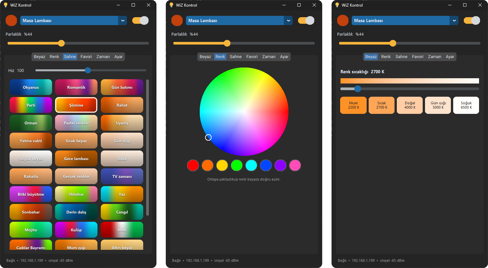
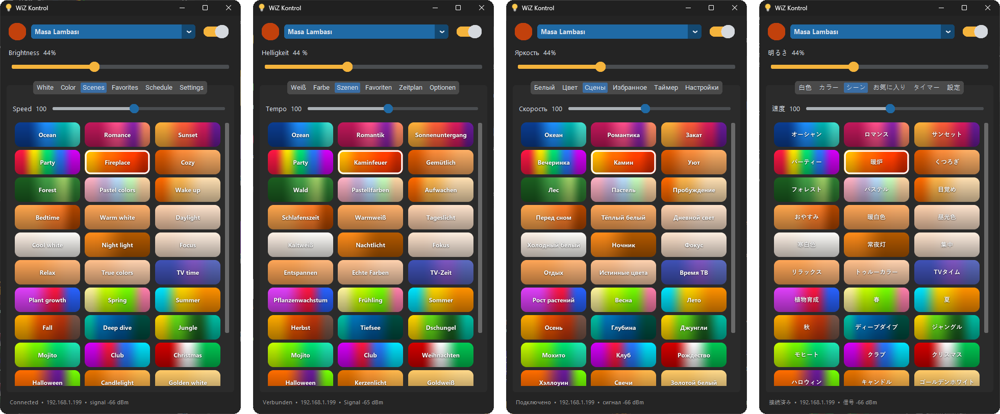
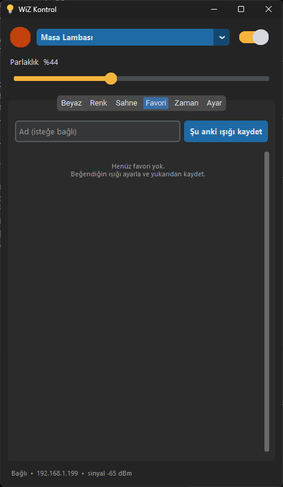
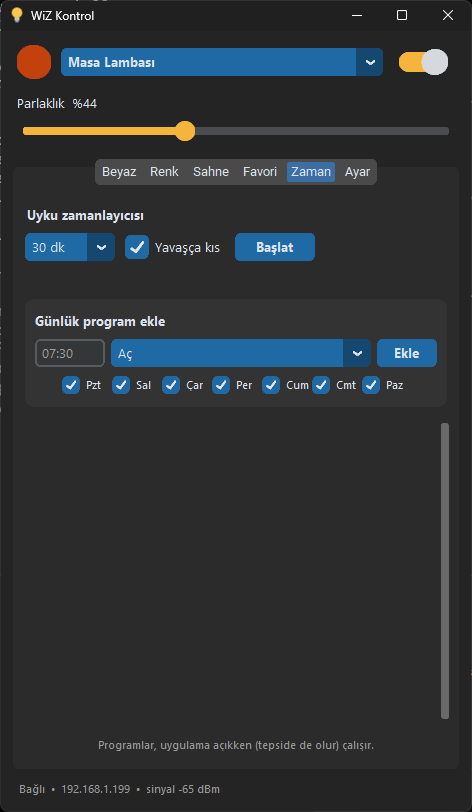
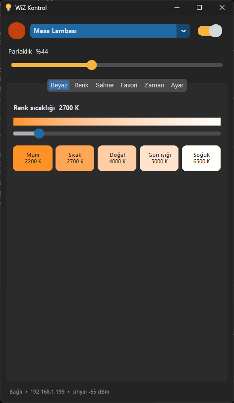
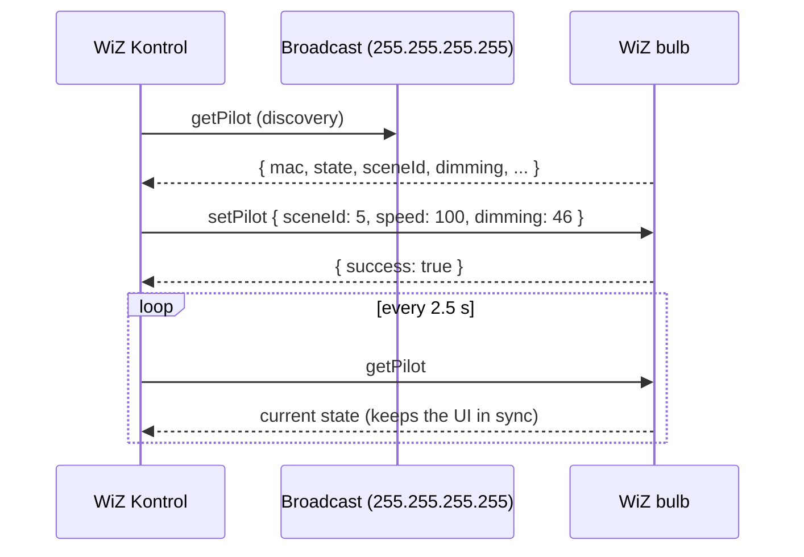

<div align="center">


# WiZ Kontrol

**A fast, native-feeling Windows app for Philips WiZ smart bulbs — straight over your local network. No cloud, no account, no phone.**

[](https://github.com/HyadeNN/wiz-kontrol/actions/workflows/ci.yml)
[](https://github.com/HyadeNN/wiz-kontrol/releases/latest)


[](LICENSE)

[**Download**](https://github.com/HyadeNN/wiz-kontrol/releases/latest) · [Features](#features) · [Getting started](#getting-started) · [How it works](#how-it-works) · [Build from source](#build-from-source) · [Türkçe](README.tr.md)



</div>

---

## Why?

WiZ has apps for Android and iOS, but **nothing official for Windows** — and with Windows Subsystem for Android retired in 2025, there's no easy way to run the phone app either. WiZ Kontrol fills that gap: open it from the taskbar or the system tray and your light reacts instantly, because commands go **directly to the bulb on your Wi-Fi**, not through a server on the other side of the world.

## Features

| | |
|---|---|
| 💡 **Power & brightness** | One switch, one slider (10–100 %). Changes land in milliseconds. |
| 🌡️ **Tunable white** | 2200 K – 6500 K slider with a live temperature gradient, plus *Candle / Warm / Natural / Daylight / Cool* presets. |
| 🎨 **Full-color wheel** | Hue + saturation wheel and quick swatches. Pastels use the bulb's cold-white channel, so they look clean instead of washed-out. |
| ✨ **35 built-in scenes** | Ocean, Fireplace, Party, Sunset, Christmas, … each tile is drawn as a **gradient of the colors that scene cycles through, weighted by how long each color stays on**. Adjustable speed. |
| ⭐ **Favorites** | Save the current light in one click. Name it, or leave the name empty and it's named for you (e.g. *Fireplace*, *Warm 2700 K*, *Light blue*). |
| ⏰ **Schedules** | Daily programs per weekday: turn on, turn off, apply a favorite, a **30-minute sunrise wake-up**, or a 30-minute fade-out. |
| 🌙 **Sleep timer** | 15–120 min, optionally dimming gradually until the light goes off. |
| 🖥️ **System tray** | Lives next to the clock. Right-click for on/off, brightness and favorites; the tray icon takes the bulb's current color. |
| 🔄 **Always in sync** | Change the light from the phone app or a voice assistant and WiZ Kontrol picks it up within seconds. |
| 🏠 **Multiple bulbs** | Auto-discovers every WiZ bulb on the network; control one, or all of them at once. Rename them as you like. |
| 🚀 **Start with Windows** | Optional, starts quietly in the tray. Single-instance: launching it again just brings the window back. |
| 🌍 **10 languages** | English, Türkçe, Deutsch, Español, Français, Italiano, Português, Русский, 中文, 日本語 — picked automatically from your Windows language, switchable in Settings. Scene names are translated too. |

<p align="center"></p>

<details>
<summary><b>More screenshots</b></summary>
<br>
<p align="center">



</p>
</details>

## Getting started

### 1. Allow local communication (one-time)

WiZ bulbs only accept local commands when you allow it:

**WiZ app → Settings → Security → Allow local communication → On**

Make sure your PC is on the **same Wi-Fi / LAN** as the bulb.

### 2. Install

1. Download **`WiZ-Kontrol-vX.Y.Z.exe`** from the [latest release](https://github.com/HyadeNN/wiz-kontrol/releases/latest).
2. Put it wherever you like (e.g. `%LOCALAPPDATA%\Programs\WiZ Kontrol\`) and run it.
3. Your bulbs are discovered automatically.

> [!TIP]
> The exe isn't code-signed, so SmartScreen may say *"Windows protected your PC"*. Click **More info → Run anyway**. You can always [build it yourself](#build-from-source) from this source.

Settings, favorites and schedules are stored in `%APPDATA%\WizKontrol\config.json`, so they survive updates.

## How it works

WiZ bulbs speak a small JSON protocol over **UDP port 38899** on the local network. WiZ Kontrol uses it directly:



<details>
<summary><b>Protocol cheat-sheet</b></summary>

| Method | Params | Purpose |
|---|---|---|
| `getPilot` | – | Current state: `state`, `dimming`, and either `temp`, `r/g/b/c/w` or `sceneId` + `speed` |
| `setPilot` | `{"state": true}` | On / off |
| `setPilot` | `{"dimming": 10‥100}` | Brightness, keeps current mode |
| `setPilot` | `{"temp": 2200‥6500}` | Tunable white |
| `setPilot` | `{"r","g","b": 0‥255, "c","w": 0‥255}` | RGB + cold/warm white channels |
| `setPilot` | `{"sceneId": 1‥36, "speed": 10‥200}` | Built-in dynamic scenes |
| `getSystemConfig` | – | Model (`moduleName`), firmware, MAC |

Example: `{"method":"setPilot","params":{"temp":2700,"dimming":60}}`

UDP is unreliable by nature, so every command is retried with a short timeout, and a background sender coalesces rapid slider movements so only the latest value per bulb is sent.

</details>

### What works offline vs. what needs the cloud

| ✅ Works locally (this app) | ☁️ Still needs the WiZ app |
|---|---|
| On/off, brightness, white, color, scenes | Control from outside your home network |
| Favorites, schedules, sleep timer | Alexa / Google Assistant integration |
| Multi-bulb control, live sync | Firmware updates, adding new bulbs to Wi-Fi |

Schedules created in WiZ Kontrol run while the app is open (the tray counts).

## Build from source

Requires **Python 3.10+** on Windows.

```bash
git clone https://github.com/HyadeNN/wiz-kontrol.git
```

```bash
cd wiz-kontrol
```

```bash
python -m pip install -e ".[dev]"
```

```bash
python -m wizkontrol
```

Run the tests and the linter:

```bash
python -m pytest
```

```bash
python -m ruff check .
```

Build the standalone exe (output: `dist\WiZ Kontrol.exe`):

```bash
powershell -ExecutionPolicy Bypass -File scripts\build.ps1
```

Pushing a `v*` tag builds the exe in GitHub Actions and attaches it to a release automatically.

### Project layout

```
wizkontrol/
├── protocol.py   # UDP protocol: wiz_request, discover, Sender (coalescing background sender)
├── colors.py     # Kelvin / HSV ↔ bulb channels, mode detection, auto-naming
├── i18n.py       # UI strings & scene names in 10 languages, Windows language detection
├── scenes.py     # Scene list, per-scene color palettes & weights, presets
├── graphics.py   # App icon, color wheel, gradient scene tiles (Pillow)
├── config.py     # %APPDATA% config + "start with Windows"
└── app.py        # UI (CustomTkinter), tray icon (pystray), timers & schedules
tests/            # Fake-bulb UDP tests, color/scene tests, translation completeness checks
scripts/build.ps1 # PyInstaller one-file build
```

### Adding a language

Every string in [`i18n.py`](wizkontrol/i18n.py) is a tuple with one entry per language. Add your language code to `LANGUAGES`, append a translation to each tuple (and to `SCENE_NAMES`), then run `python -m pytest`: the tests point out any string you missed or any placeholder (`{n}`, `{ip}`, …) that doesn't match.

## Roadmap

- [ ] Global hotkeys (e.g. <kbd>Ctrl</kbd>+<kbd>Alt</kbd>+<kbd>L</kbd> to toggle)
- [ ] Screen-color sync (ambilight-style)
- [ ] Bulb groups / rooms
- [ ] Light theme

Ideas and PRs are welcome — open an [issue](https://github.com/HyadeNN/wiz-kontrol/issues).

## Notes

- **Scene gradients are approximations.** WiZ doesn't publish the exact color sequences or timings of its scenes and the bulb doesn't report them, so palettes in [`scenes.py`](wizkontrol/scenes.py) are based on how each scene looks. Corrections are very welcome.
- Tested with a WiZ RGB + tunable-white bulb (`ESP25_SHRGB_01`, firmware 1.38). Other WiZ models that support local UDP control should work; white-only bulbs will reject color commands.

## License & disclaimer

[MIT](LICENSE) © 2026 Hüseyin Efe Karagöz

This is an independent project and is **not affiliated with, endorsed by, or sponsored by Signify or Philips**. WiZ and Philips are trademarks of their respective owners.
